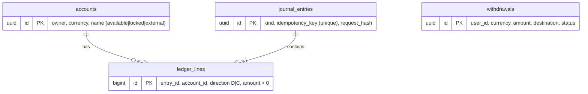

# phantom-ledger

Double-entry ledger service for a crypto exchange, written in TypeScript (Fastify + PostgreSQL). It tracks user balances, deposits, withdrawals, order holds, and trade settlement, and can prove the books balance.

> Demo/portfolio project. Not audited. Do not use it to hold real funds without a security review.

## Design

- **Double entry:** every operation is one journal entry whose debit and credit lines balance per currency. Entries are rejected otherwise.
- **Integer money:** amounts are integer strings in minor units (`numeric(78,0)` in Postgres, `bigint` in code). No floats anywhere.
- **Balance convention:** `balance = credits - debits`. User accounts (`available`, `locked`) cannot go negative; the `system/external` account represents the outside world (the chain) and can.
- **Available vs locked:** `hold` moves funds from `available` to `locked` (backing an open order); `release` moves them back; trades settle from `locked`.
- **Concurrency safety:** accounts touched by an entry are locked with `SELECT ... FOR UPDATE` in a fixed id order (no deadlocks), and balances are checked under the lock. A `CHECK (balance >= 0)` constraint is the last line of defense.
- **Idempotency:** every write needs an `Idempotency-Key`. Replays return the original result (`replayed: true`); the same key with a different payload returns `409`. Trades use `trade:<tradeId>` as their key.
- **Append-only:** triggers block `UPDATE`/`DELETE` on `ledger_lines` and `journal_entries`.
- **Reconciliation:** `GET /reconcile` checks debits = credits per currency, cached balances = balances derived from ledger lines, and no illegal negatives.

### Schema



### Money flows

| Operation | Debit | Credit |
|---|---|---|
| Deposit | system external | user available |
| Transfer | sender available | receiver available |
| Hold | user available | user locked |
| Release | user locked | user available |
| Withdrawal request | user available | user locked |
| Withdrawal confirm | user locked | system external |
| Withdrawal fail | user locked | user available |
| Trade settle | buyer locked (quote), seller locked (base) | seller available (quote), buyer available (base) |

## Run it

```bash
docker compose up -d        # PostgreSQL
cp .env.example .env
npm install
npm run dev                 # applies migrations, listens on :3000
npm test                    # needs the database running
```

## API

All write endpoints (except confirm/fail) require an `Idempotency-Key` header. Amounts are integer strings.

```bash
curl -X POST localhost:3000/deposits -H 'content-type: application/json' -H 'idempotency-key: dep-1' \
  -d '{"userId":"alice","currency":"USDT","amount":"1000000"}'

curl -X POST localhost:3000/withdrawals -H 'content-type: application/json' -H 'idempotency-key: wd-1' \
  -d '{"userId":"alice","currency":"USDT","amount":"400000","destination":"0xabc..."}'

curl localhost:3000/balances/alice
curl localhost:3000/reconcile
```

| Method | Path | Purpose |
|---|---|---|
| POST | `/deposits` | Credit a user |
| POST | `/transfers` | Move funds between users |
| POST | `/holds`, `/holds/release` | Lock / unlock funds for orders |
| POST | `/trades/settle` | Settle a matched trade atomically |
| POST | `/withdrawals` | Request a withdrawal (locks funds) |
| POST | `/withdrawals/:id/confirm` \| `/fail` | Finish a withdrawal |
| GET | `/balances/:userId` | Available and locked per currency |
| GET | `/reconcile` | Verify the books |

Errors use `{ "error": { "code", "message" } }` with `400` (validation), `404`, `409` (idempotency mismatch / invalid state), `422` (insufficient funds).

## Tests

25 tests (Vitest, real PostgreSQL) cover idempotency (including concurrent replays), insufficient funds, no overdraw under 10 concurrent withdrawals, opposing transfers without deadlock, withdrawal lifecycle, atomic trade settlement, tamper detection, and append-only enforcement.

## Roadmap

Fees, per-entry audit metadata, authentication, pagination of entries, and wiring to `phantom-matcher` (call `/trades/settle` on every trade event).
